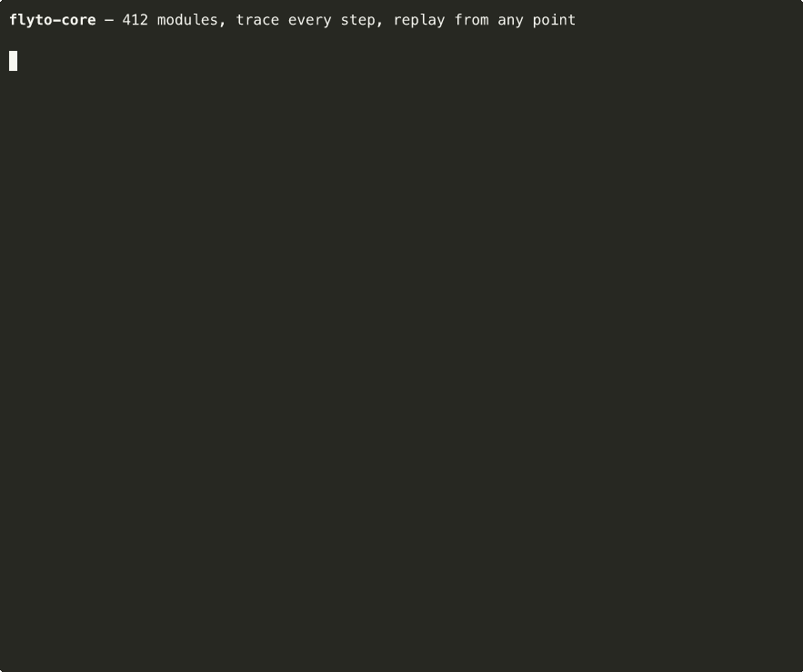

<h1 align="center">Flyto2</h1>

  <strong>STOP CHATTING. START DOING.</strong> 
  <em>Give AI a way to act — across browsers, APIs, workflows, and real ROS 2 robots.</em>

  <a href="README.md">English</a> · <a href="README.ja.md">日本語</a> · <a href="README.ko.md">한국어</a> · <a href="README.zh-CN.md">简体中文</a> · <a href="README.es.md">Español</a> · <a href="README.pt-BR.md">Português (BR)</a>

  
  
  

<!-- mcp-name: io.github.flytohub/flyto-core -->

## Your AI has ideas. Give it tools.

A model can explain how to do something. **Flyto2 turns those steps into actions you can actually run.**

**Open the page. Click the button. Call the API. Move the data. Run the workflow.**

And yes, **Flyto2 already connects to ROS 2 robots through external adapters.** The robot uses its own ROS 2 / Nav2 software. Flyto2 is the software execution layer, **not robot firmware or a motor controller**.

| | What you can do |
|---|---|
| 🌐 **Web** | Open pages, click, extract data, take screenshots |
| ⚡ **APIs** | Chain requests and transform responses |
| 🧩 **Workflows** | Turn multi-step jobs into reusable automations |
| 🔌 **MCP** | Give compatible AI agents a real execution toolbox |
| 🤖 **ROS 2** | Connect standard ROS 2 robots through host-side adapters |
| 🦾 **Capabilities** | Describe device actions, limits and evidence with portable contracts |

**482 modules · 89 categories · 41 ready-to-run recipes** in the current Core inventory.

## Watch it run

  

*This is a real software-workflow recording. The ROS 2 integration runs separately; this GIF is not a robot demo.*

## Run your first workflow

~~~bash
python -m pip install "flyto-core[browser]"
playwright install chromium

# Go to a real page, collect information and save the results.
flyto recipe competitor-intel --url https://github.com/pricing
~~~

That's a working command, not a mock screenshot. To explore more:

~~~bash
flyto recipes
flyto modules
flyto run my-workflow.yaml
~~~

## Software that reaches the real world

Our robotics connection doesn't replace ROS 2. It **uses ROS 2**.

~~~text
Human / AI agent
       |
       v
Flyto2 AI Space          goal, device choice, permissions
       |
       v
flyto-core               workflow, execution, contracts, trace
       |
       +--> Browser / API / Files / MCP
       |
       +--> Approved external adapter
                  |
                  +--> ROS 2 / Nav2 --> TurtleBot3
~~~

The [Flyto2 robotics adapter](https://github.com/flytohub/flyto-robotics) is developed against real TurtleBot3 equipment. The latest combined end-to-end physical acceptance is still a separate verification step — we don't present a software integration as an already certified robot deployment.

**One device software stack, one pack.** Drivers, motors, robot models and vendor SDKs live outside Core. Core stays independent of the brand of robot, arm or connected device.

## Give your agent the toolbox

### MCP

~~~bash
python -m pip install flyto-core
python -m core.mcp_server
~~~

Configure that command in your MCP client to expose Core tools. **MCP access alone does not authorize moving a physical robot.** The trusted host still controls device access.

### Python

~~~python
import asyncio
from core.modules.registry import ModuleRegistry

async def main():
    result = await ModuleRegistry.execute(
        "string.reverse",
        params={"text": "Flyto2"},
        context={},
    )
    print(result)

asyncio.run(main())
~~~

### Local HTTP API

~~~bash
python -m pip install "flyto-core[api]"
flyto serve
~~~

By default the server binds to 127.0.0.1:8333. Do not expose it publicly without the proper authentication and network controls.

## Built to run. Built to know what happened.

Every serious execution engine needs to answer three questions: **What ran? What changed? What happens next?**

Flyto2 records each step, supports checkpoints and bounded replay, and checks declared execution evidence. An action's “success” response is not automatically proof that a physical goal was achieved. The Flyto2 host / AI Space handles approvals, independent observations and the final task verdict.

That technology is underneath the experience — **the experience is doing real work.**

**Less chat. More action.**

[Website](https://flyto2.com) · [Documentation](https://docs.flyto2.com) · [PyPI](https://pypi.org/project/flyto-core/) · [YouTube](https://www.youtube.com/@Flyto2) · [Issues](https://github.com/flytohub/flyto-core/issues)

Package name: <code>flyto-core</code>. Product: <strong>Flyto2</strong>. Open source under the <a href="LICENSE">Apache License 2.0</a>. Report vulnerabilities through <a href="https://github.com/flytohub/flyto-core/security/advisories">GitHub Security Advisories</a>.
